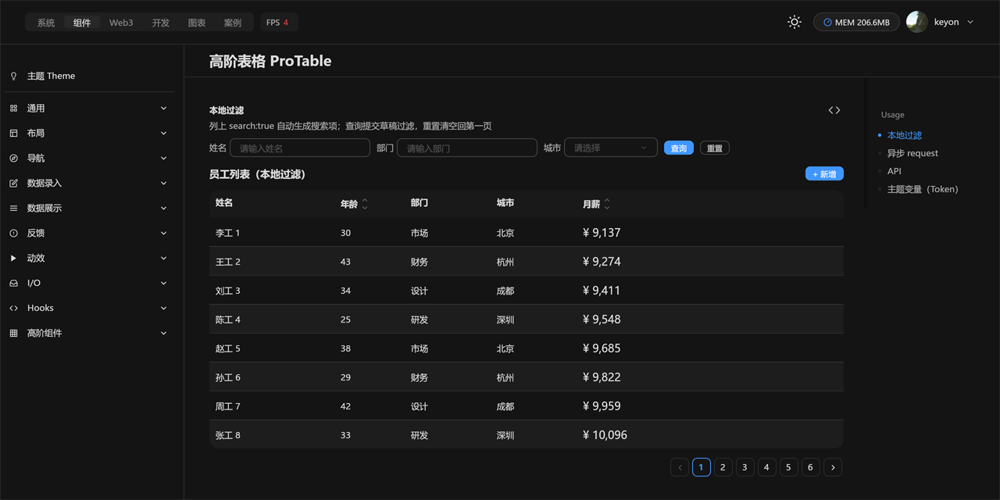
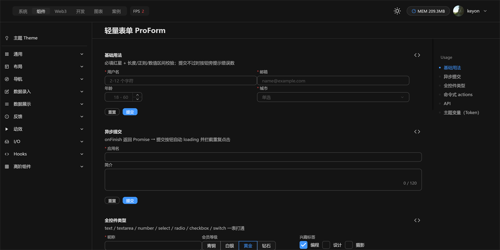
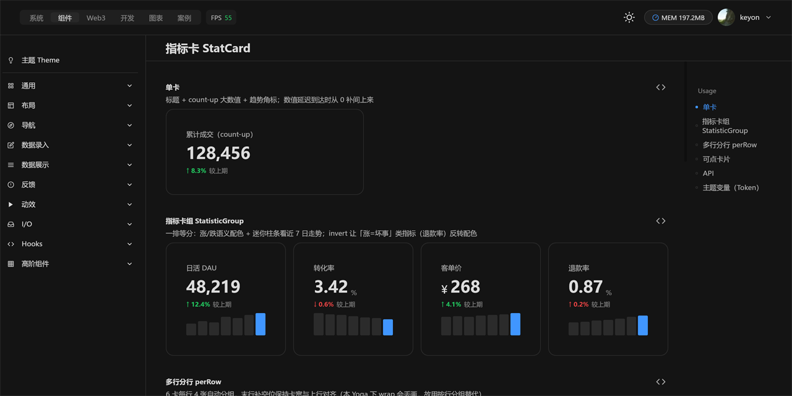

# react-native-flux-desktop-pro

> 🧩 Ready‑to‑use, mid/back‑office composite components — built on top of the atomic UI kit.
> 🧩 开箱即用的高阶组件 —— 组合既有原子件，面向中后台业务场景。

  

**Depends on / 依赖：** `react-native-flux-desktop`（UI core / UI 核心）· `react-native-flux-desktop-chart`（内嵌迷你图 / sparkline）· `react`

---



**EN** · ProTable ships search‑form + column config + async `request` + pagination out of the box; ProForm, StatCard, CheckCard, TrendCard, PriceCard round out a full CRUD/dashboard toolkit — all theme‑aware via design tokens.

**中文** · ProTable 内置查询表单 + 列配置 + 异步 `request` + 分页；搭配 ProForm、StatCard、CheckCard、TrendCard、PriceCard 构成完整的增删改查 / 仪表盘工具箱——全部经 Token 感知主题。

| 高阶表格 ProTable | 轻量表单 ProForm | 指标卡 StatCard |
| :---: | :---: | :---: |
|  |  |  |

## Install / 安装

```bash
npm install react-native-flux-desktop react-native-flux-desktop-chart   # peers
npm install react-native-flux-desktop-pro
```

## Usage / 用法

```tsx
import { useState } from 'react';
import { ProTable, type ProColumn } from 'react-native-flux-desktop-pro';

const columns: ProColumn[] = [
  { title: 'Name', dataIndex: 'name', search: true },
  { title: 'Age', dataIndex: 'age', sorter: true },
  { title: 'Salary', dataIndex: 'salary', render: (v) => `¥ ${v}` },
];

export default () => {
  const [rows, setRows] = useState<any[]>([]);
  // Controlled async: fetch inside request and write back to dataSource (request returns nothing)
  return (
    <ProTable
      columns={columns}
      dataSource={rows}
      request={(params) => { fetchRows(params).then(setRows); }}
    />
  );
};
```

## Components / 组件清单

- `ProTable` 高阶表格 — 搜索表单 / 列配置 / 异步 request / 分页
- `ProForm` 轻量表单 — 声明式字段、校验规则、`actions` 受控
- `ProDescriptions` 描述列表 — 键值详情展示
- `ProCard` 高阶卡片 — 可折叠面板容器
- `StatCard` / `StatisticGroup` 指标卡 / 统计组 — 数值 + 趋势
- `CheckCard` / `CheckCardGroup` 可选卡片 — 单选 / 多选
- `TrendCard` 趋势卡 · `PriceCard` / `PriceTable` 价格卡 / 定价表
- `Highlight` 文本高亮 — 关键词命中着色

## Notes / 说明

- **EN** Composite layer: it consumes atomic UI components (and `SparklineChart` from the chart package) internally — you only import from this package's root.
- **中文** 组合层：内部消费原子组件（及图表包的 `SparklineChart`），你只需从本包根入口导入。

## License / 许可证

MIT
